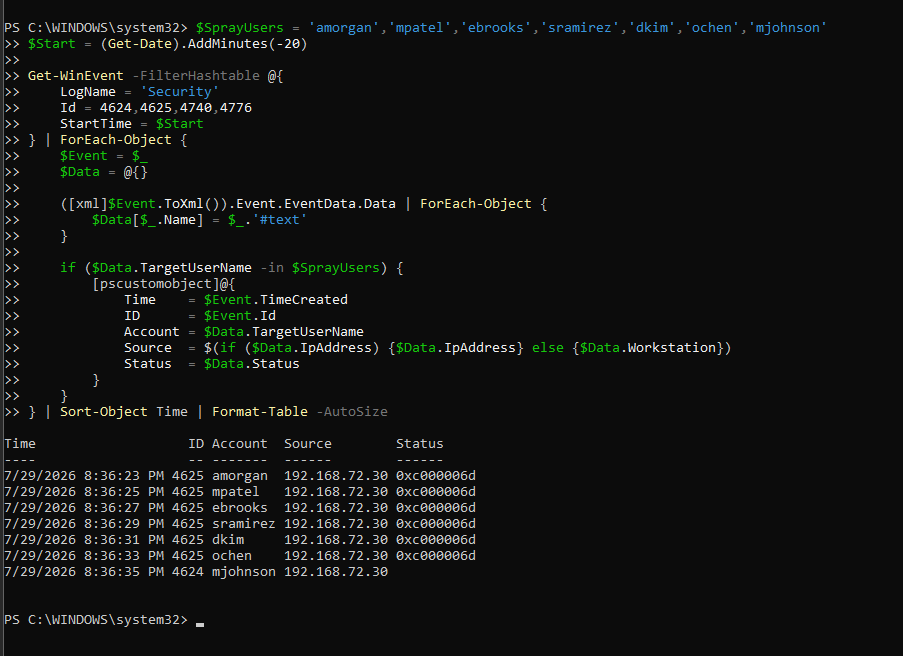
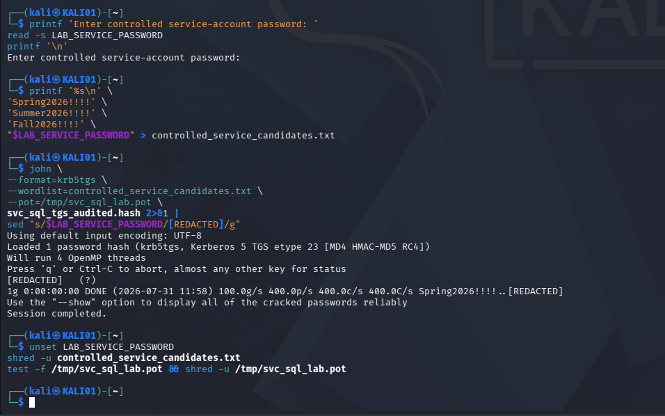
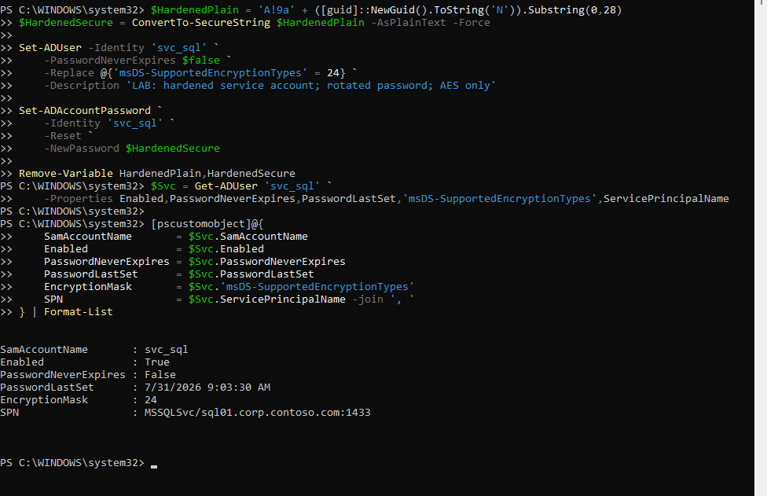
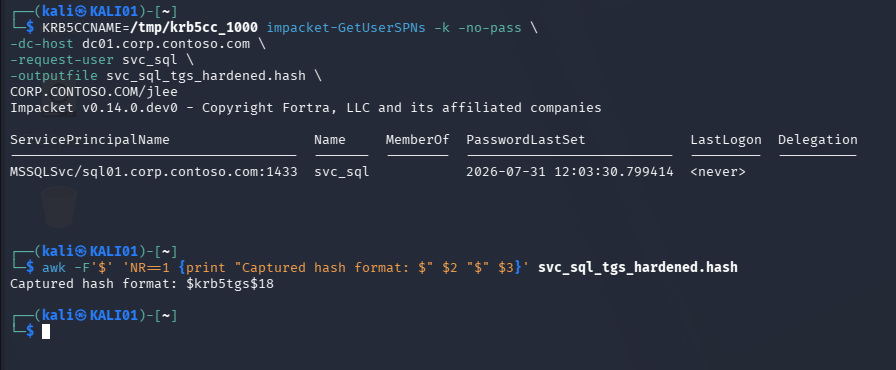
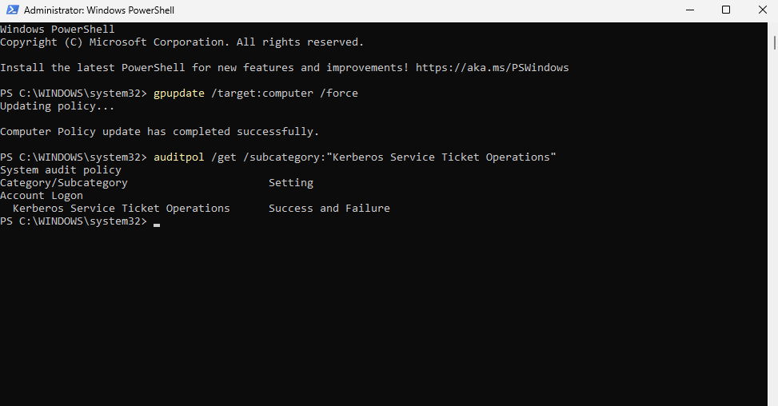

# Project 2: Active Directory Attack Simulation and Security Hardening

[Portfolio home](../README.md) · [Browse all screenshots](Screenshots/README.md)

## Overview

In this project, I tested an Active Directory lab from a Kali Linux system to investigate how exposed services, weak credentials, and service-account configuration could affect domain security.

I performed reconnaissance, compared unauthenticated and authenticated access, and conducted a controlled password-spraying demonstration using an intentionally weak test password. I investigated the authentication activity, validated account-lockout behavior, and evaluated service-account hardening through repeat ticket requests.

The project also included a Kerberoasting demonstration, service-account hardening, and troubleshooting Kerberos auditing that was being reverted by Group Policy.

All testing took place inside my own lab systems with designated test accounts.
Weak credentials were intentional for demonstration purposes.

## Objectives

- Identify reachable services on the domain controller and Windows client.
- Compare unauthenticated access with low-privilege authenticated access.
- Demonstrate the impact of an intentionally weak password.
- Correlate test activity with Windows authentication events.
- Validate account-lockout behavior.
- Demonstrate the risk of a weak service-account password.
- Apply security changes and evaluate the resulting behavior.
- Configure Kerberos auditing that continued after Group Policy refresh.

## Lab Environment

| Component | Purpose |
| --- | --- |
| KALI01 | Kali Linux system used for reconnaissance and controlled attack simulations |
| DC01 | Active Directory domain controller and source of domain security events |
| CLIENT01 | Windows domain client included in service discovery |
| Active Directory and Domain Name System (DNS) | Domain identity, authentication, and service discovery |
| Server Message Block (SMB) | Share enumeration and access testing |
| Lightweight Directory Access Protocol (LDAP) | Directory enumeration |
| Kerberos | Authentication and service-ticket testing |
| Windows security logs | Authentication, lockout, and Kerberos investigation |
| Group Policy | Persistent security audit configuration |

This project is built on the Active Directory environment that was created in Project 1.

## 1. Baseline Validation and Network Configuration

I began by validating the lab environment and configuring KALI01 with a static network configuration.

I then performed initial scans against CLIENT01 and DC01 to identify reachable services. The results established a starting point for the assessment and helped determine which services could be examined from Kali.

An open port was treated as evidence of a reachable service, rather than proof of a vulnerability.

**Supporting screenshots:** [01](Screenshots/01_Project2_Baseline_Validation.png), [02](Screenshots/02_KALI01_Static_Network_Configuration.png), [03](Screenshots/03_CLIENT01_Initial_Port_Scan.png), [04](Screenshots/04_DC01_Initial_AD_Service_Scan.png)

## 2. Unauthenticated Enumeration

I examined what information could be obtained without domain credentials.

This included DNS enumeration and LDAP RootDSE enumeration. I also tested anonymous LDAP directory access and anonymous SMB share access.

The captured results showed that anonymous directory access and anonymous SMB share access were denied.

This stage helped distinguish information available through service discovery from resources that required authentication.

**Supporting screenshots:** [05](Screenshots/05_Unauthenticated_AD_DNS_Enumeration.png), [06](Screenshots/06_Unauthenticated_LDAP_RootDSE_Enumeration.png), [07](Screenshots/07_Anonymous_LDAP_Directory_Access_Denied.png), [08](Screenshots/08_Anonymous_SMB_Share_Access_Denied.png)

## 3. Low-Privilege Authenticated Enumeration

I used a low-privilege domain account to compare authenticated access with earlier unauthenticated results.

The testing included:

- Authenticated SMB share enumeration.
- Low-privilege SMB access validation.
- An insecure LDAP bind attempt that was rejected.
- Kerberos authentication.
- Kerberos-authenticated LDAP enumeration.
- Group membership enumeration.
- Computer object enumeration.
- Password and account-lockout policy enumeration.

The results demonstrated that a low-privilege account could provide additional visibility into the domain without having administrative access.

The low-privilege account could list SYSVOL and NETLOGON, while access to the administrative C$ share was denied. The simple LDAP bind returned `Strong(er) authentication required (8)`; the Kerberos-authenticated workflow succeeded.

The enumerated policy required a minimum password length of 14 characters, retained 24 passwords, and used a lockout threshold of 5 attempts with a 15-minute duration and reset window. These values were already present during enumeration.

**Supporting screenshots:** [09](Screenshots/09_Authenticated_SMB_Share_Enumeration.png), [10](Screenshots/10_Low_Privilege_SMB_Access_Validation.png), [11](Screenshots/11_Insecure_LDAP_Bind_Rejected.png), [12](Screenshots/12_Low_Privilege_Kerberos_Authentication.png), [13A](Screenshots/13A_Kerberos_Authenticated_LDAP_Enumeration.png), [13B](Screenshots/13B_Kerberos_Authenticated_LDAP_Enumeration.png), [14](Screenshots/14_AD_Group_Membership_Enumeration.png), [15](Screenshots/15_AD_Computer_Enumeration.png), [16](Screenshots/16_AD_Password_and_Lockout_Policy_Enumeration.png), including 13a and 13b

## 4. Controlled Password-Spraying Demonstration

I prepared a limited target list and purposefully created a weak password on a designated lab account.

I used NetExec (`nxc`) over SMB for a controlled password spray from Kali. The source capture showed a `[+]` result for `CORP\mjohnson`, confirming successful authentication with the intentionally weak credential. Several other attempts timed out; those connection errors were not treated as failed-credential results.

The demonstration was restricted to lab accounts. The successful-authentication capture is withheld from the public evidence because its output still displays the lab password. The account setup and related Windows event captures are included.

**Supporting screenshots:**

- [17 — Safe password-spray target lists.](Screenshots/17_Safe_Password_Spray_Target_List.png)
- [18 — Controlled weak-password configuration.](Screenshots/18_Controlled_Weak_Password_Configuration.png)
- Screenshot 19: Successful authentication capture withheld pending password redaction.

## 5. Authentication Event Investigation

After the password spray, I reviewed security events on DC01 to investigate the authentication activity.

I examined the spray-related events and detailed authentication records to connect the activity observed from Kali with the domain controller's records.

I reviewed failed-logon events (Event ID 4625) and successful-logon events (Event ID 4624) as part of the authentication investigation.

This provided a defensive view of the test and helped connect attack-side output with domain-side evidence.

**Supporting screenshots:**

- [20 — Password-spray event correlation on DC01.](Screenshots/20_DC01_Password_Spray_Event_Correlation.png)
- [21 — Detailed authentication events.](Screenshots/21_Password_Spray_Detailed_Authentication_Events.png)

## 6. Controlled Account-Lockout Validation

I tested the existing lockout policy with `lockout.test`. The capture showed `LockedOut: True` and `badPwdCount: 5`.

I then reviewed the associated security events to match the account state with the test activity. The test account was unlocked and then disabled afterward.

This stage was used to demonstrate the importance of checking a control's actual behavior instead of only relying on its configured settings.

**Supporting screenshots:**

- [22 — Controlled account-lockout confirmation.](Screenshots/22_Controlled_Account_Lockout_Confirmation.png)
- [23 — Account-lockout event correlation.](Screenshots/23_Account_Lockout_Event_Correlation.png)
- [24 — Lockout test account retired.](Screenshots/24_Lockout_Test_Account_Retired.png)

## 7. Evaluating Account Controls

The initial password spray demonstrated the risk of the intentionally weak credential. The separate lockout exercise confirmed that the tested account could be locked out and that the associated activity could be investigated in the security logs.

These observations support a limited conclusion: weak credentials allowed access during the first test, and the lockout control worked under the conditions tested. A successful lockout test does not establish that every password-spraying technique has been prevented.

**Supporting screenshots:** [17](Screenshots/17_Safe_Password_Spray_Target_List.png), [18](Screenshots/18_Controlled_Weak_Password_Configuration.png), [20](Screenshots/20_DC01_Password_Spray_Event_Correlation.png), [21](Screenshots/21_Password_Spray_Detailed_Authentication_Events.png), [22](Screenshots/22_Controlled_Account_Lockout_Confirmation.png), [23](Screenshots/23_Account_Lockout_Event_Correlation.png), [24](Screenshots/24_Lockout_Test_Account_Retired.png)

## 8. Kerberoasting Demonstration

I configured the lab service account `svc_sql` with an intentionally weak password and the service principal name (SPN) `MSSQLSvc/sql01.corp.contoso.com:1433`. I used Impacket GetUserSPNs to request a service ticket and John the Ripper for the controlled offline password-recovery test.

The screenshot sequence includes offline recovery of the intentionally weak service-account password. The recovered credential was redacted from the evidence.

This demonstrated the importance of protecting service-account credentials and reviewing their configuration.

**Supporting screenshots:**

- [25 — Vulnerable service-account configuration.](Screenshots/25_Vulnerable_Service_Account_Configuration.png)
- [26 — Kerberoasting service-ticket request.](Screenshots/26_Kerberoasting_Service_Ticket_Request.png)
- [31 — Offline password recovery, redacted.](Screenshots/31_Kerberoasting_Offline_Password_Recovery_REDACTED.png)

## 9. Kerberos Auditing Gap and Event Correlation

During service-ticket testing, I identified a gap in Kerberos service-ticket auditing.

I enabled the relevant auditing and repeated the ticket request. The subsequent evidence included an audited request and correlation with Event ID 4769.

Event ID 4769 records Kerberos service-ticket requests. In this project, the known test activity provided the context needed to investigate the corresponding event.

**Supporting screenshots:**

- [27 — Kerberos service-ticket auditing gap.](Screenshots/27_Kerberos_Service_Ticket_Audit_Gap.png)
- [28 — Kerberos service-ticket auditing enabled.](Screenshots/28_Kerberos_Service_Ticket_Auditing_Enabled.png)
- [29 — Audited Kerberoasting ticket request.](Screenshots/29_Audited_Kerberoasting_Ticket_Request.png)
- [30 — Event ID 4769 correlation.](Screenshots/30_Kerberoasting_4769_Event_Correlation.png)

## 10. Service-Account Hardening and Retesting

After the Kerberoasting demonstration, I rotated the `svc_sql` password, changed `PasswordNeverExpires` to `False`, and set `msDS-SupportedEncryptionTypes` to decimal `24` (the AES128/AES256 flags). I verified the account settings and requested another ticket to evaluate the resulting behavior.

The evidence includes hardened account verification and a post-hardening Advanced Encryption Standard, 256-bit (AES256) ticket request. A separate pre-hardening capture identifies a Rivest Cipher 4 (RC4) ticket with an AES256 session key.

The post-hardening capture showed `$krb5tgs$18`, consistent with AES256 ticket encryption. The earlier Windows event showed ticket encryption `0x17` and session-key encryption `0x12`.

Ticket encryption and session-key encryption are different fields. I compared the ticket encryption field when evaluating the before-and-after results.

**Supporting screenshots:**

- [32 — Hardened service-account verification.](Screenshots/32_Hardened_Service_Account_Verification.png)
- [33 — Post-hardening AES256 ticket request.](Screenshots/33_Post_Hardening_AES256_Ticket_Request.png)
- [34 — Pre-hardening RC4 ticket with AES256 session key.](Screenshots/34_Pre_Hardening_RC4_Ticket_AES256_Session_Key.png)

The observed change was in ticket encryption. It does not establish that Kerberoasting became impossible; service-account password strength remains important.

## 11. Persistent Kerberos Auditing Through Group Policy

Further validation showed that Group Policy was reverting the Kerberos auditing setting.

I reviewed the Group Policy Objects (GPOs) applied to DC01, configured persistent Kerberos auditing through Group Policy, and verified the effective setting after a policy refresh.

The final check ran `gpupdate /target:computer /force`, then `auditpol /get` for Kerberos Service Ticket Operations. The effective result remained **Success and Failure**.

This explained why the earlier local auditing change did not remain in effect.

The troubleshooting process showed the importance of identifying which policy controls a setting and checking that the desired configuration survives a refresh.

**Supporting screenshots:**

- [35 — Kerberos auditing reverted by Group Policy.](Screenshots/35_Kerberos_Auditing_Reverted_By_Group_Policy.png)
- [36 — Group Policy objects applied to DC01.](Screenshots/36_DC01_Applied_Group_Policy_Objects.png)
- [37 — Persistent Kerberos auditing configured through a GPO.](Screenshots/37_Persistent_Kerberos_Auditing_GPO_Configured.png)
- [38 — Persistent auditing verified after a Group Policy refresh.](Screenshots/38_Persistent_Kerberos_Auditing_Verified_After_GPUpdate.png)

## Key Findings

| Finding | Evidence |
| --- | --- |
| Anonymous LDAP directory and SMB share access attempts were denied | Screenshots 07-08 |
| Low-privilege credentials enabled additional domain enumeration | Screenshots 09-16 |
| An intentionally weak credential allowed successful authentication | Screenshots 17-19 |
| Authentication and account-lockout activity could be investigated through security events | Screenshots 20-23 |
| An intentionally vulnerable service account supported offline password recovery | Screenshots 25-26 and 31 |
| Kerberos service-ticket auditing initially had a visibility gap | Screenshots 27-30 |
| Service-account hardening was followed by ticket-encryption validation | Screenshots 32-34 |
| Persistent auditing required addressing the applied Group Policy configuration | Screenshots 35-38 |

## Lessons Learned

- Establish a baseline before making changes.
- Separate service discovery, authenticated enumeration, and successful credential use.
- Compare attack-side output with domain-side evidence.
- Distinguish newly implemented controls from existing controls that were tested.
- Verify the correct encryption field when comparing Kerberos tickets.
- Check security settings again after Group Policy refresh.
- Limit conclusions to what the captured evidence actually demonstrates.

## Skills Demonstrated

- Active Directory reconnaissance and enumeration
- Controlled password-spraying and Kerberoasting simulations
- Windows authentication and account-lockout investigation
- Kerberos service-ticket analysis
- Security event correlation
- Service-account hardening
- Group Policy troubleshooting
- Remediation validation
- Evidence collection and credential redaction

## Outcome

This project connected controlled attack simulations with defensive investigation, security changes, and repeat testing.

The initial demonstrations showed the consequences of deliberately weak credentials. The investigation and hardening work provided experience validating account controls, examining Kerberos ticket behavior, and maintaining audit settings through Group Policy.

## Technical Reference

- [Microsoft: Event ID 4769 — A Kerberos service ticket was requested](https://learn.microsoft.com/en-us/previous-versions/windows/it-pro/windows-10/security/threat-protection/auditing/event-4769)

## Technical Reference

[Microsoft: Event ID 4769 and ticket-encryption fields](https://learn.microsoft.com/en-us/previous-versions/windows/it-pro/windows-10/security/threat-protection/auditing/event-4769).

## Screenshot Index

[Browse the complete screenshot index](Screenshots/README.md) for the remaining setup, investigation, and validation evidence.
