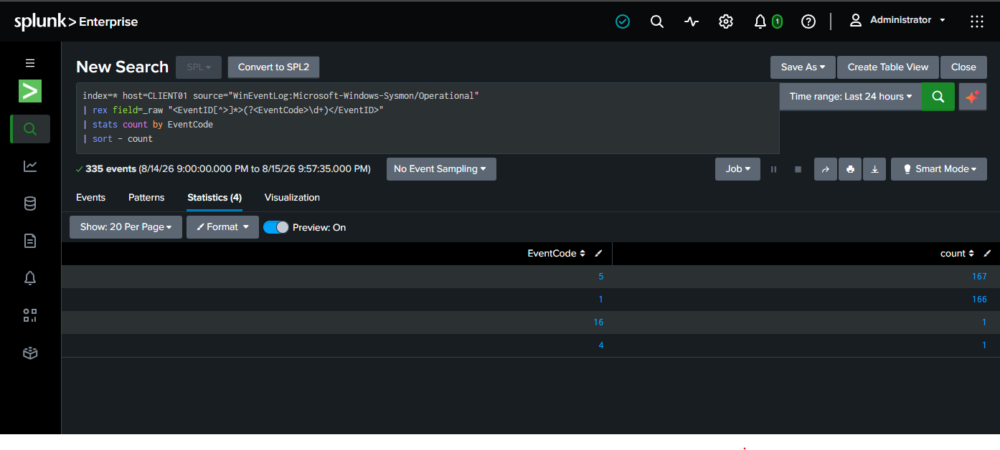
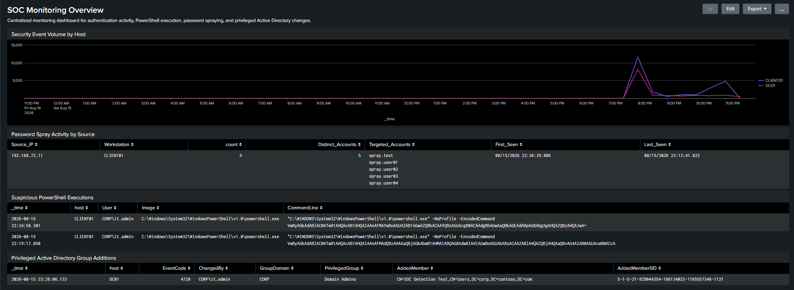
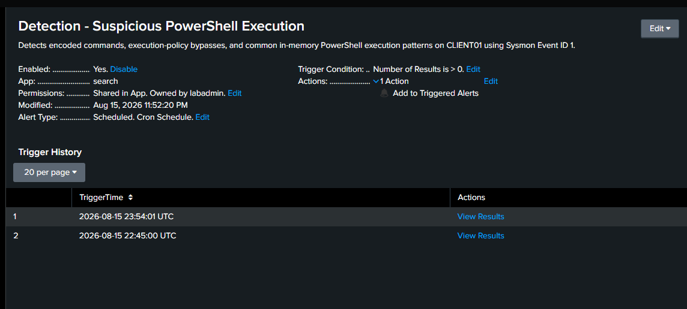
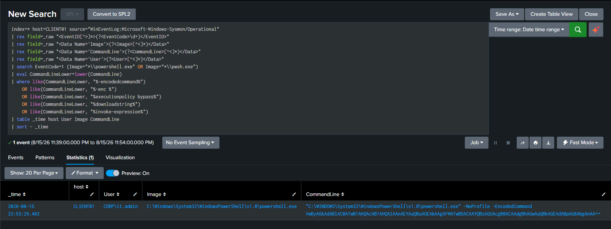

# Project 3: Splunk SIEM Deployment and Security Monitoring

[Portfolio home](../README.md) · [Browse all screenshots](Screenshots/README.md)

## Overview

In this project, I deployed Splunk Enterprise on a Linux virtual machine and configured centralized log collection for the Active Directory lab I built in Project 1.

I connected the domain controller and Windows client using Splunk Universal Forwarders, collected Windows event logs and Sysmon data, and created searches to identify security activity.

I also configured alerts and built a security operations center (SOC) monitoring dashboard to summarize activity across the environment.

The project concluded with a suspicious PowerShell test to validate that an alert triggered and returned matching results.

Splunk served as the lab’s security information and event management (SIEM) platform, bringing endpoint and authentication logs into one place for investigation.

## Objectives

- Deploy Splunk Enterprise on a dedicated Linux server.
- Collect Windows event logs from DC01 and CLIENT01.
- Collect Sysmon events from CLIENT01.
- Create and validate security detection searches.
- Configure alerts for suspicious activity.
- Build a centralized SOC monitoring dashboard.
- Test an alert and review its matching events.

## Lab Environment

| System | Role |
| --- | --- |
| SIEM01 | Linux server running Splunk Enterprise |
| DC01 | Active Directory domain controller and log source |
| CLIENT01 | Windows endpoint and log source |

All simulations were performed within my personal lab.

## Tools and Technologies

- Splunk Enterprise
- Splunk Universal Forwarder
- System Monitor (Sysmon)
- Windows Event Logs
- Active Directory
- Linux
- PowerShell
- Splunk Search Processing Language (SPL)

## 1. SIEM Server Setup

I configured the Linux SIEM server with a static IP address and validated its gateway, Domain Name System (DNS) settings, and network connectivity.

I also checked time synchronization to support consistent timestamps when reviewing events from multiple systems.

After configuring the server, I installed Splunk Enterprise, completed its initial startup, and checked the service status and installed version.

I then accessed the Splunk web interface and signed in to confirm the application was available.

**Supporting screenshots:** [01](Screenshots/01_SIEM01_Static_IP_Configured.png), [02](Screenshots/02_SIEM01_Gateway_and_DNS_Validation.png), [03](Screenshots/03_SIEM01_Network_and_DNS_Connectivity.png), [04](Screenshots/04_SIEM01_NTP_and_Time_Synchronization.png), [05](Screenshots/05_Splunk_Enterprise_Initial_Start.png), [06](Screenshots/06_Splunk_Service_Status_and_Version.png), [07](Screenshots/07_Splunk_Web_Login_Accessible.png), [08](Screenshots/08_Splunk_Web_Dashboard_Access.png)

## 2. Configuring Log Reception

I enabled Splunk's receiving listener on port 9997.

This prepared the Splunk server to receive forwarded data from the Windows systems in the lab.

During the forwarder installations, I configured the receiving destination to point to the SIEM server.

**Supporting screenshots:** [09](Screenshots/09_Splunk_Receiving_Port_9997_Enabled.png)

## 3. Collecting Domain Controller Logs

I installed Splunk Universal Forwarder on DC01.

During installation, I configured the forwarder options, selected Windows event logs for collection, and specified the receiving Splunk server.

After completing the installation, I searched Splunk to confirm that DC01 events were arriving.

I also checked the collected event log sources to validate the forwarding configuration.

**Supporting screenshots:** [10](Screenshots/10_DC01_Universal_Forwarder_Setup.png), [11](Screenshots/11_DC01_Universal_Forwarder_Install_Path.png), [12](Screenshots/12_DC01_Forwarder_SSL_Certificate_Options.png), [13](Screenshots/13_DC01_Forwarder_Service_Account.png), [14](Screenshots/14_DC01_Forwarder_Event_Log_Selection.png), [15](Screenshots/15_DC01_Forwarder_Admin_Credentials.png), [16](Screenshots/16_DC01_Forwarder_Deployment_Server.png), [17](Screenshots/17_DC01_Forwarder_Receiving_Indexer.png), [18](Screenshots/18_DC01_Forwarder_Ready_to_Install.png), [19](Screenshots/19_DC01_Universal_Forwarder_Installation_Complete.png), [20](Screenshots/20_DC01_Logs_Received_in_Splunk.png), [21](Screenshots/21_DC01_All_Event_Logs_Verified.png)

## 4. Collecting Windows Client Logs

I installed Splunk Universal Forwarder on CLIENT01 and configured it to send Windows event logs to the SIEM.

After installation, I verified that CLIENT01 events appeared in Splunk and checked the standard event log sources being collected.

This established centralized visibility into both the domain controller and the Windows client.

**Supporting screenshots:** [22](Screenshots/22_Client01_Universal_Forwarder_Setup.png), [23](Screenshots/23_Client01_Forwarder_Install_Path.png), [24](Screenshots/24_Client01_Forwarder_SSL_Options.png), [25](Screenshots/25_Client01_Forwarder_Service_Account.png), [26](Screenshots/26_Client01_Forwarder_Event_Log_Selection.png), [27](Screenshots/27_Client01_Forwarder_Admin_Credentials.png), [28](Screenshots/28_Client01_Forwarder_Deployment_Server.png), [29](Screenshots/29_Client01_Forwarder_Receiving_Indexer.png), [30](Screenshots/30_Client01_Forwarder_Ready_to_Install.png), [31](Screenshots/31_Client01_Universal_Forwarder_Installation_Complete.png), [32](Screenshots/32_Client01_Logs_Received_in_Splunk.png), [33](Screenshots/33_Client01_All_Standard_Event_Logs_Verified.png)

## 5. Collecting Sysmon Events

I configured a forwarding input for CLIENT01's Sysmon event log.

I verified that Sysmon events reached Splunk and reviewed a summary of the collected event IDs.

This provided additional endpoint telemetry for the process investigation and detection exercises.

**Supporting screenshots:** [34](Screenshots/34_Client01_Sysmon_Input_Configuration.png), [35](Screenshots/35_Client01_Sysmon_Events_Received.png), [36](Screenshots/36_Client01_Sysmon_Event_ID_Summary.png)

## 6. PowerShell Hunting and Detection

I created and validated a search for PowerShell process activity and saved a hunting report.

I then developed a suspicious PowerShell detection search, checked its results, and configured an alert.

This exercise connected endpoint telemetry with a repeatable search and alerting workflow.

**Supporting screenshots:** [37](Screenshots/37_PowerShell_Process_Hunt_Validated.png), [38](Screenshots/38_PowerShell_Hunt_Report_Created.png), [39](Screenshots/39_Suspicious_PowerShell_Detection_Validated.png), [40](Screenshots/40_Suspicious_PowerShell_Alert_Configuration.png), [41](Screenshots/41_Suspicious_PowerShell_Alert_Created.png)

## 7. Repeated Failed Logon Detection

I reviewed failed network logon events from DC01.

Using those events, I validated a detection search for repeated failed logons and created an associated alert.

The goal was to identify patterns of authentication failures that could warrant investigation.

**Supporting screenshots:** [42](Screenshots/42_DC01_Failed_Network_Logon_Events.png), [43](Screenshots/43_Repeated_Failed_Logon_Detection_Validated.png), [44](Screenshots/44_Repeated_Failed_Logon_Alert_Configuration.png), [45](Screenshots/45_Repeated_Failed_Logon_Alert_Created.png)

## 8. Password Spray Detection

I performed a controlled password spray simulation within the lab.

I validated a Splunk search against the resulting activity and configured a password spray alert.

This exercise focused on identifying the authentication pattern in collected logs.

**Supporting screenshots:** [46](Screenshots/46_Password_Spray_Simulation.png), [47](Screenshots/47_Password_Spray_Detection_Validated.png), [48](Screenshots/48_Password_Spray_Alert_Configuration.png), [49](Screenshots/49_Password_Spray_Alert_Created.png)

## 9. Privileged Group Change Detection

I simulated a privileged group membership change and validated that the Domain Admins membership change was visible in Splunk.

I then configured an alert for privileged group changes.

After the exercise, I completed cleanup of the temporary privileged account used for testing.

**Supporting screenshots:** [50](Screenshots/50_Privileged_Group_Change_Simulation.png), [51](Screenshots/51_Domain_Admins_Membership_Change_Validated.png), [52](Screenshots/52_Privileged_Group_Change_Alert_Configuration.png), [53](Screenshots/53_Privileged_Group_Change_Alert_Created.png), [54](Screenshots/54_Temporary_Privileged_Account_Cleanup.png)

## 10. SOC Monitoring Dashboard

I created a SOC monitoring dashboard with panels for:

- Event volume by host.
- Password spray activity.
- Suspicious PowerShell activity.
- Privileged group changes.

The dashboard brought several monitoring views into one location for reviewing lab activity.

**Supporting screenshots:** [55](Screenshots/55_SOC_Event_Volume_by_Host.png), [56](Screenshots/56_SOC_Monitoring_Dashboard_Created.png), [57](Screenshots/57_SOC_Password_Spray_Activity_Panel.png), [58](Screenshots/58_SOC_Suspicious_PowerShell_Panel.png), [59](Screenshots/59_SOC_Privileged_Group_Changes_Panel.png), [60](Screenshots/60_Final_SOC_Monitoring_Dashboard.png)

## 11. Final Alert Validation

I performed a final suspicious PowerShell test and verified that the associated alert triggered.

I reviewed the matching results to connect the alert with the activity that generated it.

After testing, I restored the alert schedule.

This provided a complete validation sequence: generate test activity, collect the events, trigger the alert, and inspect the results.

**Supporting screenshots:** [61](Screenshots/61_Final_Suspicious_PowerShell_Alert_Test.png), [62](Screenshots/62_Suspicious_PowerShell_Alert_Triggered.png), [63](Screenshots/63_Triggered_Alert_Matching_Results.png), [64](Screenshots/64_Suspicious_PowerShell_Alert_Schedule_Restored.png)

## Results

- Deployed Splunk Enterprise on the Linux SIEM server.
- Configured log reception on port 9997.
- Forwarded Windows event logs from DC01 and CLIENT01.
- Collected and reviewed CLIENT01 Sysmon events.
- Created a PowerShell hunting report.
- Validated searches for multiple security use cases.
- Configured security alerts.
- Built a SOC monitoring dashboard.
- Validated a triggered suspicious PowerShell alert and reviewed its matching results.

## Skills Practiced

- Linux server and network configuration
- Splunk administration
- Universal Forwarder deployment
- Centralized Windows log collection
- Sysmon telemetry analysis
- SPL search development
- Authentication event analysis
- Detection and alert configuration
- Dashboard creation
- Controlled security testing and cleanup

## Lessons Learned

### Verify Collection Before Building Detections

I checked that events from each Windows system were reaching Splunk before relying on detection searches.

### Additional Telemetry Supports Investigation

Collecting Sysmon events provided process information that supported the PowerShell hunting exercises.

### Search Results and Alert Execution Are Separate Checks

Validating a search showed that it could find the lab activity. Testing the PowerShell alert also confirmed that the alert executed and produced matching results.

### Dashboards Support Review

Combining multiple security views in one dashboard made it easier to review different types of lab activity.

### Testing Includes Cleanup

Temporary privileged access required cleanup, and the alert schedule needed to be restored after final testing.

## Future Improvements

- Tune detection thresholds using additional lab activity.
- Document potential false positives for each detection.
- Add investigation steps for responding to each alert.
- Expand monitoring to additional systems and use cases.

## Screenshot Index

[Browse the complete screenshot index](Screenshots/README.md) for the remaining setup, investigation, and validation evidence.
