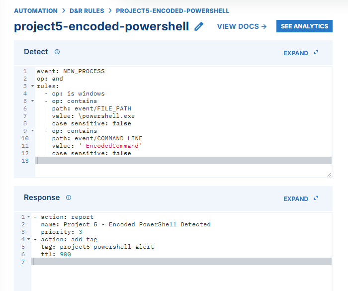
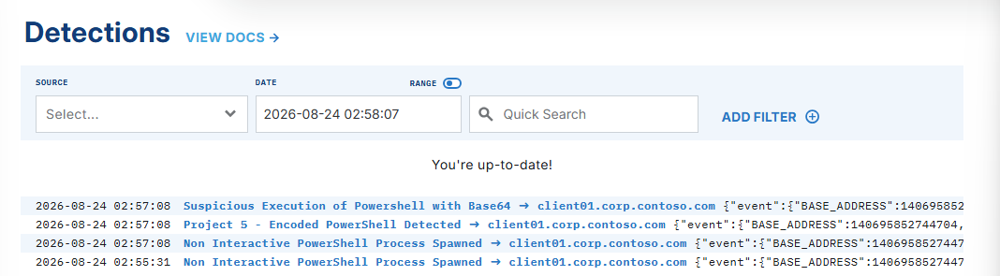
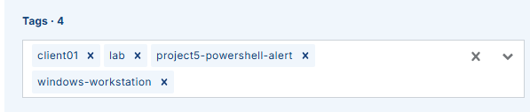
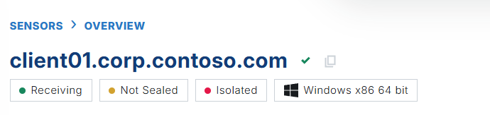

# Project 5: Endpoint Detection and Response with LimaCharlie

[Portfolio home](../README.md) · [Browse all screenshots](Screenshots/README.md)

## Project Overview

In this project, I used LimaCharlie as an endpoint detection and response (EDR) platform to practice monitoring a Windows computer, detecting suspicious activity, investigating alerts, and containing an endpoint.

I installed a LimaCharlie sensor on CLIENT01, enabled detection rules, and ran a harmless encoded PowerShell test. I then reviewed the detections and related process activity.

Finally, I practiced isolating CLIENT01 from the network, checking its connection to DC01, and restoring connectivity after the test.

This project was completed in my personal lab using controlled test activity.

## Objectives

- Connect CLIENT01 to LimaCharlie.
- Verify that endpoint activity appears in the dashboard.
- Enable Sigma detection rules.
- Create a custom rule for encoded PowerShell activity.
- Generate detections using a harmless test.
- Investigate the command and its related processes.
- Practice network isolation and recovery.
- Use the EDR console to inspect running processes.

## Tools and Environment

| Tool or System         | Purpose                                        |
| ---------------------- | ---------------------------------------------- |
| LimaCharlie           | Endpoint monitoring, detection, and response    |
| CLIENT01               | Windows endpoint used for testing              |
| DC01                   | Domain controller and connectivity test target |
| PowerShell             | Run controlled test commands                   |
| Sigma rules            | Detect potentially suspicious activity         |
| Custom detection rules | Identify the encoded PowerShell test           |

## Key Terms

- **EDR:** Endpoint Detection and Response. A tool used to monitor computers, investigate suspicious activity, and take response actions.
- **Sensor:** Software installed on a computer that sends activity to the EDR platform.
- **Telemetry:** Activity recorded from a computer, such as processes starting and commands running.
- **Encoded PowerShell:** A PowerShell command represented in an encoded format. Encoding alone does not prove that a command is malicious.
- **Process chain:** The relationship between a process and the processes that started it.
- **Network isolation:** Restricting an endpoint's network communication to help contain a potential threat.

## Phase 1: Set Up Endpoint Monitoring

I created a LimaCharlie organization and installed its sensor on CLIENT01.

After installation, I checked the sensor service and confirmed that CLIENT01 appeared online in the dashboard.

I opened the live telemetry feed to verify that LimaCharlie was receiving activity from the endpoint. I also reviewed a hostname command event to connect an action on CLIENT01 with the information shown in LimaCharlie.

### Evidence

- [01 — Organization configuration](Screenshots/01_LimaCharlie_Organization_Configuration.png)
- [02 — Empty sensor inventory before enrollment](Screenshots/02_LimaCharlie_Empty_Sensor_Inventory.png)
- [03 — CLIENT01 service verification](Screenshots/03_CLIENT01_LimaCharlie_Service_Verification.png)
- [04 — CLIENT01 sensor enrolled and online](Screenshots/04_CLIENT01_Sensor_Enrolled_Online.png)
- [05 — Live telemetry feed](Screenshots/05_CLIENT01_Live_Telemetry_Feed.png)
- [06 — Hostname process telemetry](Screenshots/06_CLIENT01_Hostname_Process_Telemetry.png)

## Phase 2: Configure Detection Rules

I enabled Sigma detection rules and created a custom rule for encoded PowerShell activity.

The custom rule gave me a specific behavior to test and investigate. I also configured an automated tagging response so that a matching detection could apply a tag to the endpoint.

This helped me practice connecting a detection condition with a response action.

### Evidence

- [07 — Sigma detection rules enabled](Screenshots/07_Sigma_Detection_Rules_Enabled.png)
- [08 — Custom encoded PowerShell detection rule](Screenshots/08_Custom_Encoded_PowerShell_Detection_Rule.png)

## Phase 3: Run a Harmless Detection Test

I ran a harmless encoded PowerShell command on CLIENT01 to test the detection setup.

After running the command, I checked LimaCharlie for alerts. The test triggered custom and Sigma detections, and I checked that the automated response tag was applied.

This demonstrated that endpoint activity was reaching LimaCharlie and being evaluated by the detection rules.

The test represented suspicious behavior without using an actual malicious payload.

### Evidence

- [09 — Harmless encoded PowerShell test](Screenshots/09_Benign_Encoded_PowerShell_Test.png)
- [10 — Custom and Sigma detections triggered](Screenshots/10_Custom_and_Sigma_Detections_Triggered.png)
- [11 — Automated response tag applied](Screenshots/11_Automated_Response_Tag_Applied.png)

## Phase 4: Investigate the Detection

I opened the detection details and reviewed the related PowerShell event in the timeline.

I examined the command information and followed the parent process chain to understand how the process started. This included reviewing the `svchost.exe` process associated with the Appinfo service in the captured process chain.

The purpose was to understand the activity behind the alert and connect it to my test.

An alert is a starting point for an investigation. The command, process relationships, and surrounding activity provide context for deciding what happened.

### Evidence

- [12 — Custom detection investigation details](Screenshots/12_Custom_Detection_Investigation_Details.png)
- [13 — Encoded PowerShell timeline event](Screenshots/13_Encoded_PowerShell_Timeline_Event.png)
- [14 — Parent process chain investigation](Screenshots/14_Parent_Process_Chain_Investigation.png)
- [15 — Root process investigation involving svchost.exe and Appinfo](Screenshots/15_Root_Process_Svchost_Appinfo.png)

## Phase 5: Practice Network Isolation

Before isolating CLIENT01, I checked its connectivity to DC01.

I then used LimaCharlie to isolate CLIENT01 and repeated the connectivity test. I checked the isolated status in the dashboard and compared the connection results before and after isolation.

This step demonstrated how an EDR tool can help contain an endpoint during an investigation.

The isolation action was performed as a separate response exercise. The automated response tested earlier applied a tag.

### Evidence

- [16 — Connectivity to DC01 before isolation](Screenshots/16_Pre_Isolation_DC01_Connectivity.png)
- [17 — Connectivity to DC01 blocked after isolation](Screenshots/17_Post_Isolation_DC01_Connectivity_Blocked.png)
- [18 — CLIENT01 isolated status](Screenshots/18_LimaCharlie_CLIENT01_Isolated_Status.png)

## Phase 6: Restore Connectivity and Inspect Processes

After completing the isolation test, I removed the network isolation and checked that CLIENT01 could communicate with DC01 again.

I also confirmed that the endpoint had rejoined the network in LimaCharlie.

Finally, I used the EDR console to retrieve process information remotely. This provided another way to inspect the endpoint during an investigation.

### Evidence

- [19 — Connectivity to DC01 restored](Screenshots/19_Post_Containment_DC01_Connectivity_Restored.png)
- [20 — CLIENT01 network rejoined status](Screenshots/20_LimaCharlie_CLIENT01_Network_Rejoined.png)
- [21 — Remote process inventory through the EDR console](Screenshots/21_Remote_Process_Inventory_via_EDR_Console.png)

## Results

- Enrolled CLIENT01 in LimaCharlie and verified live telemetry.
- Enabled Sigma rules and created a custom detection rule.
- Triggered detections with a harmless encoded PowerShell test.
- Verified an automated tagging response.
- Investigated the detection and its process chain.
- Practiced endpoint isolation and checked the effect on connectivity.
- Restored connectivity after containment testing.
- Retrieved process information through the EDR console.

## Lessons Learned

### Verify monitoring before testing detections

Checking the sensor service, online status, and live telemetry helped confirm that the endpoint was reporting activity before I tested the rules.

### Detection needs context

An encoded PowerShell command can trigger an alert, but the alert alone does not explain the command's purpose. Reviewing the command and related processes helps determine what happened.

### Process relationships help explain activity

Following the parent process chain helped me understand how the detected process was launched.

### Response actions need verification

Checking connectivity before, during, and after isolation helped me verify the effect of the response action.

### Automation can support an investigation

Automatically applying a tag showed how a detection can trigger a small response action that helps organize endpoint information.

## Skills Practiced

- EDR sensor deployment
- Endpoint telemetry review
- Sigma rule enablement
- Custom detection rule configuration
- Controlled detection testing
- Alert investigation
- Process chain analysis
- Automated endpoint tagging
- Network isolation and recovery
- Remote process inspection

## Outcome

This project connected endpoint monitoring, detection testing, alert investigation, and response in one workflow. Verifying telemetry and checking connectivity after each response action helped me confirm what the platform was actually doing.

## Screenshot Index

[Browse the complete screenshot index](Screenshots/README.md) for the remaining setup, investigation, and validation evidence.
